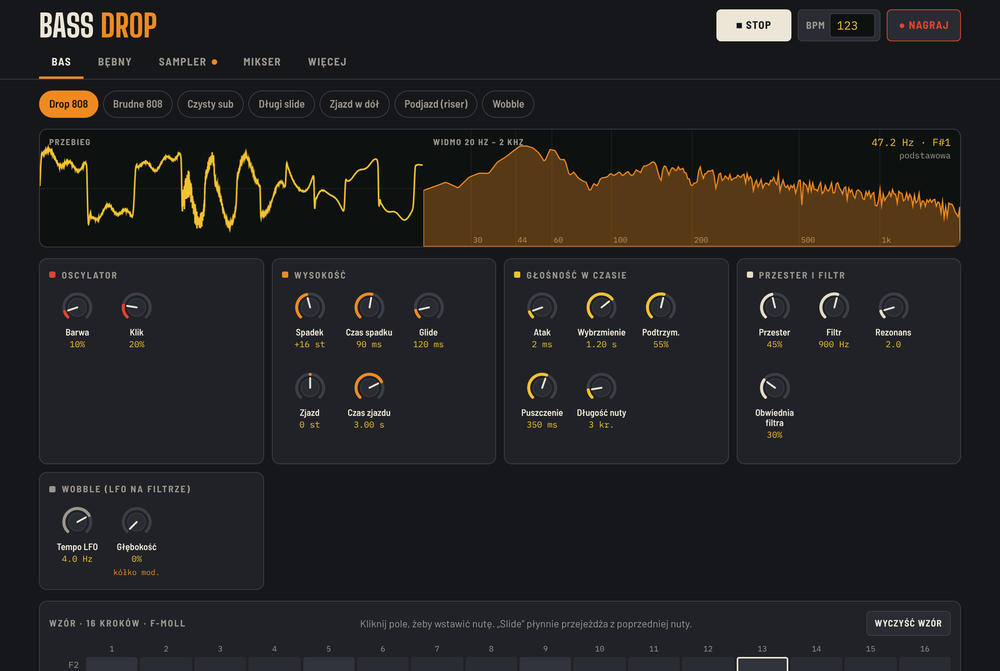
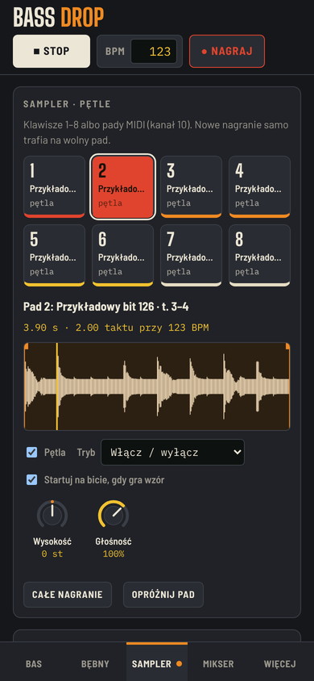

# Bass Drop

**Bas 808, bębny, sampler pętli i mikser w przeglądarce.** Bez instalowania i bez konta: otwierasz stronę i robisz bity.

*An 808 bass synth, drum machine, loop sampler and mixer that runs entirely in the browser. Drop in any track and it finds the tempo and cuts it into loops for you. UI in Polish.*

**▶ [bass-drop.vercel.app](https://bass-drop.vercel.app)** · **📖 [Instrukcja użytkownika (PDF)](docs/instrukcja.pdf)**



## Co potrafi

- **Syntezator basu 808** z 16-krokowym wzorem: spadek wysokości na ataku, glide i slide, zjazdy, przester, filtr z obwiednią, wobble (LFO na filtrze) i 7 presetów.
- **Automat perkusyjny** z syntezowanymi bębnami (stopa, werbel, klask, hi-haty) i rolkami 1/32, trioli i 1/64.
- **Cięcie utworów na pętle**: wczytujesz mp3 albo wav, apka sama wykrywa tempo i początek taktu, a Ty jednym kliknięciem rozkładasz pętle albo pojedyncze uderzenia na 8 padów. Pętle mogą od razu dopasować się do tempa projektu.
- **Sampler** na 8 padów: pętle, przycinanie, wysokość, start równo z bitem.
- **Nagrywanie** całego miksu albo mikrofonu, z dokładnością do próbki: nagranie N taktów zapętla się bez przeskoku. Eksport do WAV.
- **Mikser** z miernikami, mute, solo i sidechainem od stopy, żeby bas i stopa się nie zlewały.
- **Kontroler MIDI**: nuty, pitch bend, kółko modulacji, sustain, przypisywanie gałek, pady na kanale 10.
- **Działa na telefonie**, a wszystkie nagrania zostają w Twojej przeglądarce. Nic nie trafia na serwer.



## Jak to jest zrobione

Całość działa w przeglądarce, na czystym **Web Audio API**, bez żadnych bibliotek audio:

- syntezator i bębny są generowane w czasie rzeczywistym (oscylatory, szum, filtry, waveshaper),
- sekwencer planuje nuty z wyprzedzeniem na zegarze audio, więc rytm nie gubi się przy przerysowaniu interfejsu,
- nagrywanie idzie przez **AudioWorklet**, co daje dokładność do jednej próbki,
- wykrywanie tempa i taktów (spectral flux, autokorelacja, dopasowanie siatki do całego utworu) liczy się w **Web Workerze**,
- dopasowanie pętli do tempa robi `OfflineAudioContext`.

Interfejs: **React 19**, **TypeScript**, **Zustand**, **Vite**. Nagrania są w IndexedDB, ustawienia w localStorage. Hosting na Vercel.

## Uruchomienie u siebie

```bash
npm install
npm run dev
```

Otwórz adres z terminala (domyślnie http://localhost:5180) w Chrome lub Edge. Na localhost działają MIDI i mikrofon bez HTTPS.

`npm run build` tworzy statyczne pliki w `dist/`. Hosting musi mieć HTTPS, bo wymagają tego Web MIDI, mikrofon i AudioWorklet.

## Skróty klawiszowe

| Klawisz | Działanie |
|---|---|
| Spacja | start i stop wzoru |
| A W S E D F T G Y H U J K | klawisze syntezatora, dwa naraz = slide |
| Z / X | oktawa niżej / wyżej |
| 1–8 | pady samplera |
| R | nagrywanie |
| Shift+1…5 | sekcje: Bas, Bębny, Sampler, Mikser, Więcej |

Plik audio możesz przeciągnąć w dowolne miejsce strony, żeby pociąć go na pętle.

## Struktura kodu

- `src/audio/` – silnik dźwięku poza Reactem: `engine` (syntezator i wyjście), `drums` (bębny), `mixer` (kanały, mute/solo, sidechain), `sequencer`, `recorder` (AudioWorklet), `sampler`, `beats` + `slicer` (analiza i cięcie kawałków), `midi`, `wav`
- `src/control.ts` – łączy wejścia (ekran, klawiatura, MIDI) z modułami audio
- `src/store.ts` – stan w Zustand; ustawienia w localStorage, dźwięk nagrań w IndexedDB
- `src/components/` – interfejs
- `docs/` – instrukcja użytkownika i zrzuty ekranu

## Licencja

[MIT](LICENSE): możesz używać, zmieniać i rozpowszechniać kod, także komercyjnie, pod warunkiem zachowania informacji o autorze i licencji.
